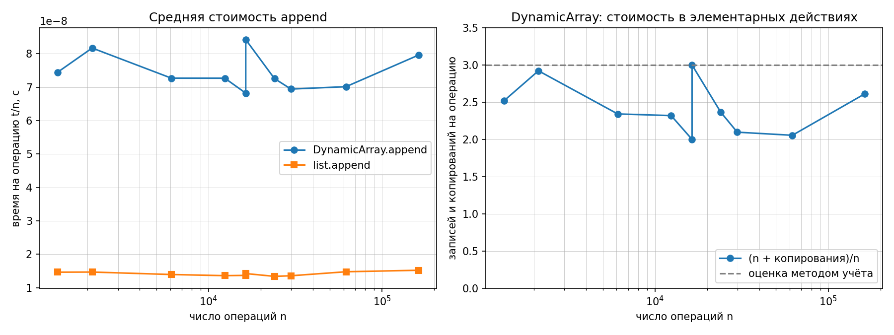
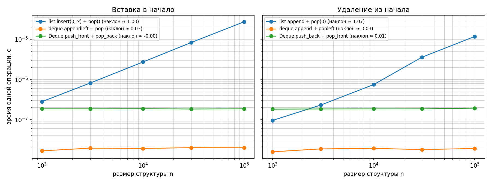

# Лабораторная работа 2. Рекурсивные функции, динамический массив, стек и дек

**КИМ-02** · **Вариант 2** (seed = 30 + 2 = **32**) · Бирук Павел

Условия замеров: Apple M4 Max, macOS 26; Python 3.13.0, matplotlib 3.10.9;
ноутбук от сети.

## Цель

Освоить рекурсию как метод построения алгоритмов и реализовать базовые
линейные структуры данных, подтвердив их асимптотические свойства —
включая амортизированную сложность — замерами на данных своего варианта.

## Состав

| Файл | Содержание |
|---|---|
| [`lab02_recursion_structures.py`](lab02_recursion_structures.py) | реализация, самопроверка, замеры |
| [`figures/lab02_append.png`](figures/lab02_append.png) | стоимость `append` |
| [`figures/lab02_front.png`](figures/lab02_front.png) | операции у начала структуры (log-log) |

Данные: `make data FOS=<путь к репозиторию курса> SET=ops`. Запуск: `make lab02`.

Оформление: `make lint` — black без замечаний, pylint 10,00/10.

## Данные варианта

| Файл | Содержание |
|---|---|
| `ops_stack.txt` | 100 000 операций `push` / `pop` / `peek` |
| `ops_deque.txt` | 100 000 операций с обоих концов (25 366 / 25 321 / 24 710 / 24 603) |
| `ops_append_sizes.txt` | 1346, 2129, 6101, 12410, **16384, 16385**, 23980, 29868, 62105, 162590 |

Пара 16384 и 16385 — это 2¹⁴ и 2¹⁴ + 1, размер ровно перед расширением
буфера и сразу после него.

## Принятые решения

**Рекурсия.** `factorial` проверяет область определения явно: отрицательный
аргумент лежит ниже базового случая, и вызовы шли бы до `RecursionError`.
В `fib_memo` словарь создаётся в первом вызове и передаётся по рекурсии —
изменяемый объект нельзя ставить значением по умолчанию, он создаётся один
раз при определении функции и кэш пережил бы вызовы.

**DynamicArray.** Рост и сжатие сведены к общему `_reallocate`, который
учитывает перенесённые элементы в `copies`. Сжатие с порогом ¼: при пороге ½
массив после сжатия снова полон, и чередование `append`/`pop` на границе
копировало бы его каждый раз — Θ(n) вместо O(1)\*. Отрицательная индексация
не поддерживается, границы проверяются явно.

**Stack и Deque.** Стек обращается к `DynamicArray` только через публичный
интерфейс. Дек — двусвязный список, все четыре операции концов Θ(1) в худшем
случае. Главная тонкость — опустошение: при извлечении последнего элемента
обнуляется противоположная ссылка, иначе хвост остался бы указателем на
удалённый узел.

## Верификация

Методика курса — четыре шага, все выполнены:

| Шаг | Что сделано | Где |
|---|---|---|
| 1. Инварианты | `size ≤ capacity`; ёмкость растёт только вдвое и только при `size == capacity`; LIFO у стека; согласованность ссылок `prev`/`next` у дека | `check_dynamic_array`, `check_capacity_invariant`, `check_stack`, `check_deque_links` |
| 2. Репрезентативные тесты | пустая структура (`pop`, `peek`, `get`, `set` → `IndexError`); один элемент во всех сочетаниях концов дека; опустошение и повторное наполнение; серии через границы ёмкости 4, 8, 16, 32, 64 | `check_dynamic_array`, `check_stack`, `check_deque` |
| 3. Сверка с эталоном | `Stack` против `list`, `Deque` против `collections.deque`: результат каждой операции и размер после неё | `check_variant_ops`, случайные серии в `check_stack` и `check_deque` |
| 4. Сложность и производительность | формулы числа вызовов, анализ методом учёта, наклоны в осях log-log | разделы ниже |

Порядок извлечения из дека с обоих концов (LIFO и FIFO) проверяется шагом 3:
любое нарушение порядка даёт расхождение с `collections.deque`.

### Собственные проверки

Проверки заготовки покрывают контракт — что структура возвращает. Ниже —
внутреннее состояние, которое контракт не проверяет.

| Проверка | Инвариант |
|---|---|
| `check_capacity_invariant` | `size ≤ capacity`, ёмкость = 4·2^k — после каждой из 5000 операций смешанной серии |
| `check_shrink_threshold` | 1000 пар `append`/`pop` на границе ёмкости укладываются в один перенос |
| `check_deque_links` | обход от `_head` и от `_tail` даёт взаимно обратные последовательности; пустой дек не хранит `tail` |
| `check_recursion_edges` | `factorial(-1)` → `ValueError`; два вызова `fib_memo(30)` дают одинаковое число входов |

Проверки оформлены явными исключениями, а не `assert`: `assert` отключается
при `python -O`.

### Мутационное тестирование проверок

В код намеренно вносился дефект — фиксировалось, какая проверка его ловит:

| Дефект | Результат |
|---|---|
| порог сжатия ½ вместо ¼ | «DynamicArray»: сжатие при `size > capacity // 4`; «порог сжатия»: 128 000 копирований вместо 64 |
| `pop_front` не обнуляет `_tail` | «Deque»: ожидался `IndexError`; расхождение с эталоном на операции № 8875 |
| `memo` как изменяемый аргумент по умолчанию | «границы рекурсии»: второй вызов `fib_memo(30)` делает 1 вход вместо 59 |

Третий дефект показателен: **контрактные проверки его не видят**. Числа
Фибоначчи остаются верными, ошибку выдаёт только счётчик — функция молча
превращается в глобальный кэш.

### Вывод о применимости

**Принять.** Девять разделов самопроверки проходят, реализации совпадают с
эталонами на операциях варианта, измеренные асимптотики совпадают с
аналитическими. Ограничение: постоянный множитель 4–7× относительно
стандартных структур (объяснён ниже).

## Результаты

### Число вызовов: наивная рекурсия против мемоизации

| n | F(n) | `fib_naive` | 2·F(n+1) − 1 | `fib_memo` | 2n − 1 |
|---:|---:|---:|---:|---:|---:|
| 5 | 5 | 15 | 15 | 9 | 9 |
| 10 | 55 | 177 | 177 | 19 | 19 |
| 15 | 610 | 1 973 | 1 973 | 29 | 29 |
| 20 | 6 765 | 21 891 | 21 891 | 39 | 39 |
| 25 | 75 025 | 242 785 | 242 785 | 49 | 49 |
| 30 | 832 040 | 2 692 537 | 2 692 537 | 59 | 59 |

Измерения совпали с формулами точно на всех шести n.

C(n) = 2·F(n+1) − 1 выводится из C(n) = C(n−1) + C(n−2) + 1 заменой
D(n) = C(n) + 1, которая убирает «+1» и даёт правило Фибоначчи. Поскольку
F(n) = Θ(φⁿ), наивная рекурсия экспоненциальна. С мемоизацией каждое
k = 2…n вычисляется один раз и делает два вызова: M(n) = 1 + 2(n−1) = 2n − 1
(счётчик стоит первой строкой и считает попадания в кэш).

Разница на n = 30 — **в 45 636 раз**. Память в обоих случаях линейна.

### Амортизированный анализ `append` методом учёта

Начальная ёмкость c₀ = 4, рост ×2. Каждый `append` платит **3 монеты**: одна
за запись своего элемента, две в копилку. Расширение m → 2m копирует m
элементов и оплачивается из копилки: его оплачивают m/2 элементов,
добавленных после предыдущего расширения (m/2 · 2 = m монет).

Копилка: `bank(n) = 3n − n − copies(n) = 2n − copies(n)`, а
`copies(n) = capacity(n) − c₀`. Отсюда `(n + copies)/n = 3 − bank(n)/n`:
пока копилка неотрицательна, стоимость операции в среднем не больше 3.

| n | capacity | `copies` (замер) | capacity − c₀ | (n + copies)/n | копилка |
|---:|---:|---:|---:|---:|---:|
| 1 346 | 2 048 | 2 044 | 2 044 | 2,519 | 648 |
| 2 129 | 4 096 | 4 092 | 4 092 | **2,922** | 166 |
| 6 101 | 8 192 | 8 188 | 8 188 | 2,342 | 4 014 |
| 12 410 | 16 384 | 16 380 | 16 380 | 2,320 | 8 440 |
| **16 384** | 16 384 | 16 380 | 16 380 | **2,000** | **16 388** |
| **16 385** | 32 768 | 32 764 | 32 764 | **3,000** | **6** |
| 23 980 | 32 768 | 32 764 | 32 764 | 2,366 | 15 196 |
| 29 868 | 32 768 | 32 764 | 32 764 | 2,097 | 26 972 |
| 62 105 | 65 536 | 65 532 | 65 532 | 2,055 | 58 678 |
| 162 590 | 262 144 | 262 140 | 262 140 | 2,612 | 63 040 |

Формула совпала с замером на всех десяти размерах, копилка нигде не ушла
в минус, (n + copies)/n нигде не превысило 3 — любые n операций стоят не
больше 3n, то есть **O(1) амортизированно**.

**Пара 16384 / 16385.** При n = 16 384 буфер заполнен ровно, копилка
максимальна: 16 388 = m + c₀. Добавление одного элемента переводит массив
через границу: расширение копирует все 16 384 элемента, копилка падает до
**6 = c₀ + 2**, а стоимость подскакивает с 2,000 до 3,000 — точнее, до
3 − 6/16 385 ≈ 2,9996. Это худшая точка: сразу после расширения отношение
подходит к границе 3 вплотную, но не достигает её, потому что в копилке
остаётся c₀ + 2 монеты.

Это и есть смысл амортизированной оценки: отдельная операция стоит Θ(n), но
заранее оплачена дешёвыми. Не средний случай — вероятностной модели нет,
оценка 3n гарантирована для любой последовательности.

Время на операцию держится на уровне (6,8–8,4)·10⁻⁸ с и не растёт при росте
n от 1346 до 162 590. `list.append` быстрее примерно в пять раз при той же
асимптотике: тот же приём, но на C и с множителем роста ≈1,125.

### Операции у начала структуры

| Операция | n=1000 | n=100 000 | наклон | асимптотика |
|---|---|---|---:|---|
| `list.insert(0, x)` | 2,80·10⁻⁷ | 2,71·10⁻⁵ | **1,00** | Θ(n) |
| `deque.appendleft` | 1,67·10⁻⁸ | 2,00·10⁻⁸ | 0,03 | Θ(1) |
| `Deque.push_front` | 1,85·10⁻⁷ | 1,85·10⁻⁷ | 0,00 | Θ(1) |
| `list.pop(0)` | 9,53·10⁻⁸ | 1,17·10⁻⁵ | **1,07** | Θ(n) |
| `deque.popleft` | 1,58·10⁻⁸ | 1,91·10⁻⁸ | 0,03 | Θ(1) |
| `Deque.pop_front` | 1,82·10⁻⁷ | 1,93·10⁻⁷ | 0,01 | Θ(1) |

Время — в секундах на пару операций: операция у начала и обратная ей на
другом конце, чтобы размер структуры оставался равным n. Вторая операция
стоит O(1) и на наклон не влияет.

У `list` элементы лежат подряд и позиция задана индексом, поэтому вставка в
нулевую позицию обязана сдвинуть все n ссылок. Это не недостаток реализации,
а плата за доступ по индексу за Θ(1). У дека порядок задают ссылки, и
операции на концах не двигают остальные элементы — платой становится доступ
к середине за Θ(n).

При n = 100 000 `list.insert(0, x)` медленнее `deque.appendleft` примерно
в **1350 раз**, и разрыв растёт вместе с n.

### Операции варианта целиком

| Набор | Своя структура | Эталон | Отношение |
|---|---|---|---|
| `ops_stack.txt` | `Stack` 1,55·10⁻⁷ с | `list` 2,40·10⁻⁸ с | 6,5× |
| `ops_deque.txt` | `Deque` 1,20·10⁻⁷ с | `collections.deque` 2,65·10⁻⁸ с | 4,5× |

Множитель не связан со сложностью — наклоны показывают Θ(1) у обеих
структур. Стандартные написаны на C и работают с массивом указателей, моя
реализация выполняет интерпретируемый байт-код и создаёт объект `_Node`
на каждый элемент (56 байт со `__slots__` против 8 байт на ссылку, плюс
промахи кэша из-за разброса узлов в памяти).

## Ответы на вопросы защиты

**1. Базовое условие и стек вызовов.**
Базовый случай — вход, ответ для которого известен без рекурсивного вызова;
второй обязательный элемент — шаг, уменьшающий задачу. Стек вызовов хранит
кадры начатых и незавершённых вызовов (аргументы, локальные переменные,
точка возврата); `factorial(4)` держит 5 кадров, память Θ(n). Без базового
случая глубина растёт неограниченно и CPython прерывает выполнение
`RecursionError` на пределе 1000. В моей реализации `factorial(-1)`
отвергается сразу `ValueError`.

**2. Мастер-теорема для T(n) = a·T(n/b) + f(n).**
Сравниваем f(n) с весом рекурсии n^(log_b a):
① f полиномиально меньше → Θ(n^(log_b a)); пример — Карацуба 3T(n/2) + Θ(n).
② f того же порядка → Θ(n^(log_b a)·log n); примеры — бинарный поиск
T(n/2) + Θ(1) и сортировка слиянием 2T(n/2) + Θ(n).
③ f полиномиально больше и регулярна → Θ(f(n)); пример — бинарный поиск со
срезами T(n/2) + Θ(n) = Θ(n).
К задачам, уменьшающимся **на единицу**, теорема неприменима: у факториала
T(n) = T(n−1) + 1 и у Ханойских башен T(n) = 2T(n−1) + 1 дерево имеет n
уровней, а не log n. Для Ханоя раскрутка даёт 2ⁿ − 1 — подтверждено
самопроверкой на n = 0, 1, 2, 3, 6, 7.

**3. Амортизированный анализ `append`.**
Разбор выше. Кратко: плата 3 монеты, расширение полностью оплачивается
копилкой, копилка не уходит в минус, отсюда 3n на любые n операций. На
данных варианта при n = 16 385 копилка после расширения равна 6 монетам
(= c₀ + 2), а (n + copies)/n ≈ 2,9996 — вплотную к границе 3, но не выше.
Это не средний случай: тот усредняет по входным данным и
требует вероятностной модели, а амортизированная оценка усредняет по
последовательности операций и гарантирована даже для худшей из них.

**4. Вставка в начало: массив против двусвязного списка.**
Массив — Θ(n) (замер 2,71·10⁻⁵ с при n = 100 000, наклон 1,00), список —
Θ(1) в худшем случае (1,85·10⁻⁷ с, наклон 0,00). Накладные расходы списка
несмотря на лучшую асимптотику: 56 байт на узел против 8 байт на ссылку;
узлы разбросаны по памяти, каждый переход по ссылке — возможный промах
кэша; доступ по индексу Θ(n); постоянный множитель 4,5× относительно
`collections.deque`. Вывод: по умолчанию берут массив, список — когда
элементы часто вставляют и удаляют рядом с узлами, на которые уже есть
ссылка.

## Выводы

1. Наивная рекурсия для Фибоначчи экспоненциальна: C(n) = 2·F(n+1) − 1,
   на n = 30 это 2 692 537 вызовов против 59 с мемоизацией. Формулы совпали
   с измеренными счётчиками точно на всех шести n.
2. Амортизированная стоимость `append` при росте ×2 — O(1): измеренное число
   копирований совпало с `capacity − c₀` на всех десяти размерах, а
   (n + copies)/n нигде не превысило границу 3. На паре 16 384 / 16 385
   видно, как одна операция переводит массив через границу.
3. Порог сжатия — не деталь реализации: при ½ чередование `append`/`pop` у
   границы копирует массив каждый раз. Измерено на мутанте: 128 000
   копирований против 64.
4. Асимптотика важнее константы. Мои структуры в 4–7 раз медленнее
   стандартных при одинаковых наклонах, но `list.insert(0, x)` проигрывает
   `deque.appendleft` примерно в 1350 раз при n = 100 000, и разрыв растёт.
5. Контрактные проверки — не полная верификация. Дефект с кэшем мемоизации
   оставляет все возвращаемые значения верными и обнаруживается только
   проверкой внутреннего состояния.
