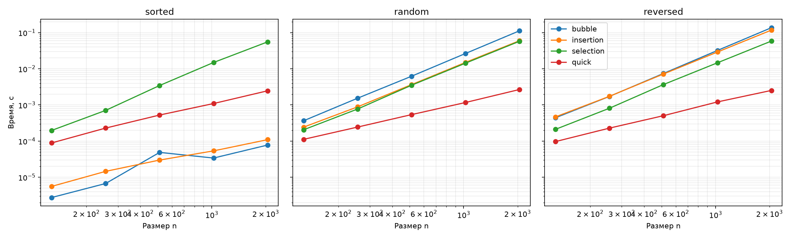

# Лабораторная работа 3. Простые сортировки и QuickSort

**КИМ-03 · вариант 2 · seed 32**

## Цель и запуск

Реализовать пузырьковую сортировку, сортировки вставками и выбором, а также QuickSort со случайным опорным элементом; проверить корректность, стабильность и измерить время на трёх классах входов.

```bash
make lab03
python3 lab03/lab03_sorts.py --variant 2 --check-only
make lint
```

Запуск `make lab03` повторяет измерения и обновляет [таблицу данных](figures/results.json) и [график](figures/lab03_times.png). Проверка неверного номера варианта завершается ошибкой. Источник требований — [КИМ-03](https://github.com/mel0d1an/data-structures-and-algorithms/blob/main/M2-sorting/kim-03-simple-sorts-quicksort.md).

## Методика

Входы создаются по заготовке курса: `Random(32 + n)` генерирует целые числа от −1 000 000 до 1 000 000; из одного набора получаются случайный, упорядоченный и обратно упорядоченный входы. Размеры: 128, 256, 512, 1024, 2048. На каждую комбинацию алгоритма, размера и класса выполняются прогрев и пять повторов; в таблице — медиана `perf_counter`. Каждый алгоритм создаёт собственную копию, поэтому вход не изменяется. Для QuickSort каждый повтор использует новый `Random(32)`; это делает выбор опорных элементов воспроизводимым. Время включает копирование и ведение счётчиков, но не проверку результата после замера. Аппаратная среда: Apple M4 Max, macOS 26.6.2, Python 3.13.0. Результаты отдельных запусков и особенно коротких операций зависят от нагрузки системы.

## Реализация и счётчики

- Пузырёк сравнивает соседние элементы, меняет их при нарушении порядка и завершает работу после прохода без обменов.
- Вставки сдвигают большие элементы вправо и вставляют элемент на найденное место.
- Выбор ищет минимум неотсортированной части и меняет его с первым элементом этой части.
- QuickSort выбирает опорный индекс через `rng.randrange(lo, hi)` и делит массив на три части: меньше, равные и больше опорного. Меньшая часть обрабатывается сразу, большая сохраняется в явном стеке. Отрезки длины 0 и 1 не разбиваются.

Сравнение — проверка двух ключей оператором `<`; в QuickSort для результата «больше или равно» выполняется второе сравнение. Для пузырька, выбора и QuickSort перемещение в таблице — **обмен двух разных позиций**. Для вставок — запись при сдвиге или окончательной вставке, если элемент изменил позицию. Это разные единицы, поэтому значения перемещений между вставками и другими алгоритмами напрямую не сопоставимы.

## Проверка корректности

Для каждого алгоритма проверены пустой массив, один элемент, 80 равных элементов, возрастающий и убывающий массивы и 500 случайных массивов. На каждом входе проверяются неизменность исходного массива, неубывание, совпадение частот элементов и равенство `sorted()`. Отдельно проверены формула числа сравнений выбора на трёх классах входов, лучший случай пузырька и вставок, стабильность пузырька и вставок на 100 массивах пар и обработка QuickSort 10 000 равных ключей. Проверки используют исключения и работают при `python -O`.

## Стабильность

Исходный массив `(ключ, метка)`: `(0,a), (0,b), (1,c), (1,d), (0,e)`; сравниваются только ключи.

| Алгоритм | Результат | Вывод |
|---|---|---|
| Пузырёк | `(0,a), (0,b), (0,e), (1,c), (1,d)` | стабилен |
| Вставки | `(0,a), (0,b), (0,e), (1,c), (1,d)` | стабилен |
| Выбор | `(0,a), (0,b), (0,e), (1,d), (1,c)` | нестабилен |
| QuickSort, seed 32 | `(0,a), (0,b), (0,e), (1,d), (1,c)` | нестабилен |

У двух первых равные элементы не переставляются. У выбора и QuickSort обмены между удалёнными позициями могут изменить порядок равных ключей. Один пример нестабильности достаточен, чтобы опровергнуть стабильность; сохранение порядка на отдельном входе её не доказывает.

## Результаты при n = 2048

| Вход | Алгоритм | Медиана, с | Сравнения | Обмены / записи |
|---|---|---:|---:|---:|
| Упорядоченный | Пузырёк | 0,000078 | 2 047 | 0 |
| Упорядоченный | Вставки | 0,000110 | 2 047 | 0 |
| Упорядоченный | Выбор | 0,055474 | 2 096 128 | 0 |
| Упорядоченный | QuickSort | 0,002460 | 40 897 | 14 616 |
| Случайный | Пузырёк | 0,112372 | 2 095 498 | 1 040 238 |
| Случайный | Вставки | 0,059872 | 1 042 280 | 1 042 277 |
| Случайный | Выбор | 0,057802 | 2 096 128 | 2 044 |
| Случайный | QuickSort | 0,002673 | 39 896 | 18 850 |
| Обратный | Пузырёк | 0,136819 | 2 096 128 | 2 096 128 |
| Обратный | Вставки | 0,117507 | 2 096 128 | 2 098 175 |
| Обратный | Выбор | 0,058471 | 2 096 128 | 1 024 |
| Обратный | QuickSort | 0,002520 | 40 147 | 15 748 |

Все 60 комбинаций, включая счётчики для пяти размеров, сохранены в JSON. Графики используют логарифмические оси:



Для оценки наклона использовано отношение крайних точек: `log(t2048/t128)/log(2048/128)`. На случайном входе получены пузырёк **2,07**, вставки **1,99**, выбор **2,03**, QuickSort **1,15**. На упорядоченном входе пузырёк — **1,21**, вставки — **1,07**; выбор — **2,03**. QuickSort на трёх классах дал **1,15–1,20**. При n от 128 до 2048 идеальная функция n·log₂n имеет наклон по крайним точкам около **1,16**, а n² — 2. Логарифмическая функция не является точной степенной, и конечные замеры не доказывают асимптотику. Особенно шумна точка пузырька на малом времени.

## Объяснение и вопросы защиты

1. **Почему выбор квадратичен?** Для каждой позиции он просматривает все оставшиеся: `(n−1) + … + 1 = n(n−1)/2` сравнений независимо от порядка входа. Вставки на готовом порядке делают `n−1` сравнений, а на обратном — квадратичное число сдвигов.
2. **Что такое стабильность?** Равные ключи сохраняют исходный порядок меток. Пузырёк меняет только строго нарушенную пару; вставки не сдвигают равный ключ. Стабильность нужна, например, при последовательной сортировке записей по нескольким полям.
3. **Откуда O(n log n) у QuickSort?** При достаточно сбалансированных разбиениях на каждом из O(log n) уровней обрабатывается O(n) элементов. Случайный опорный элемент даёт ожидаемую O(n log n) сложность; обработка равных ключей одной группой устраняет многократное разбиение одинаковых значений.
4. **Каков худший случай?** Последовательность крайне несбалансированных разбиений разных ключей даёт O(n²). Например, выбор первого элемента при обычном двухпутевом разбиении может деградировать на упорядоченном массиве. Рандомизация снижает вероятность такой последовательности, но не исключает её. Явный стек и обработка меньшей части сразу ограничивают его глубину O(log n); копия массива занимает O(n) памяти.

**Вывод:** результаты согласуются с теорией для рассматриваемого диапазона. Пузырёк и вставки используют линейный лучший случай, выбор всегда выполняет квадратичное число сравнений, а QuickSort на этих данных растёт близко к n·log n. Замеры подтверждают поведение конкретной реализации и среды, но не заменяют доказательство сложностей.
